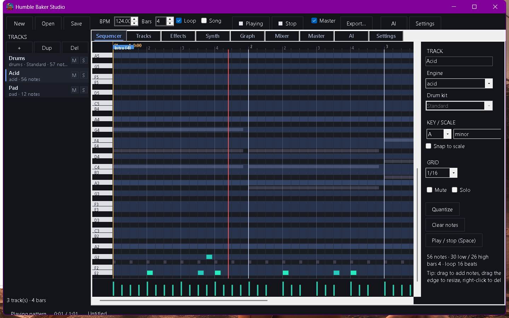
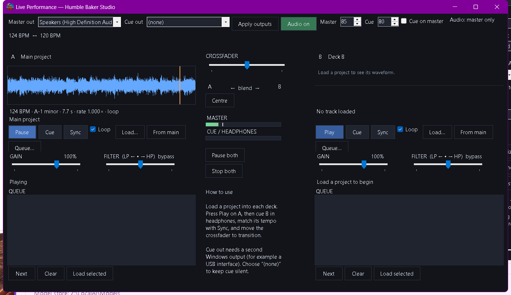
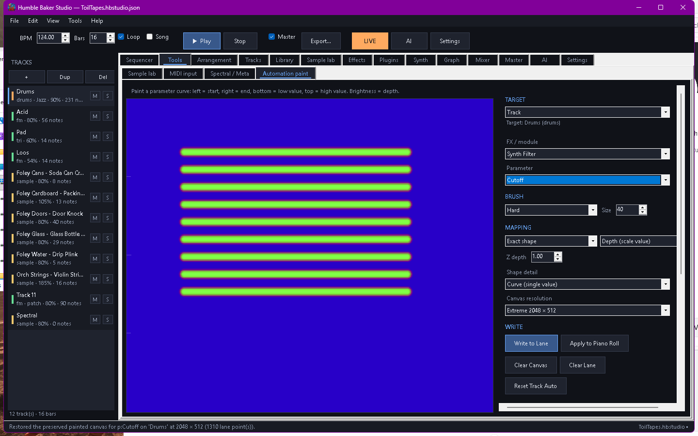

# Humble Baker Studio — C# port

An experimental, native .NET port of Humble Baker Studio. The shipped PowerShell app keeps
working; this tree is the clean-room restructuring of it into a typed, testable Windows
application.

**Status: feature-complete alpha.** The project model, synthesis engine, 113-effect DSP,
mixing, mastering, piano roll, project format, WAV export and local-AI helpers are in place,
together with the sample lab, MIDI recording, spectral painting, the meta synth, automation
painting with layered splines, the arrangement editor with editable Song Order bars overrides
and marker-driven energy, ruler marker sketching, the timeline-wide piano roll, undo/redo,
SuperCollider export and a dual-deck live performance window. 64-bit VST3 effects and
instruments are hosted on tracks and as graph FX nodes; VST2 is not supported yet. Remaining
gaps are the SuperCollider live session/OSC bridge, full effect-graph parity in the SC export,
and the PowerShell-only FLUX photo mode in the spectral painter.
See `docs/PORT.md` for the exact matrix and `docs/AUTOMATION.md` for the automation editor.
VST3 is Windows-only today; macOS Audio Unit hosting and the PowerShell VST bridge are designed
in [`docs/PLUGINS.md`](docs/PLUGINS.md).



> **This is the C# port.** The stable PowerShell studio is the root `Humble Baker Studio.exe`
> (about 1.9 MB). The C# portable exe is `CSharp-Port/Humble Baker Studio (C#).exe` (about
> 46.7 MB). See [`docs/DOWNLOADS.md`](docs/DOWNLOADS.md) for a side-by-side comparison.

## Why C#

- The original app already embedded ~6,300 lines of C# for its audio engine. The port lifts
  that code into a real class library instead of compiling it with `Add-Type` at startup.
- No `ps2exe`: a normal build produces a normal executable, with no script-packing step and no
  antivirus false positives from a self-extracting PowerShell stub.
- Static typing, real async/await, unit tests and per-feature source files.
- Only Windows/.NET or a self-contained executable: no NuGet packages at runtime, no Node,
  no Electron, no Python. FFmpeg remains optional and only for MP3/OGG/FLAC export.

## Download

A prebuilt portable build is attached to the [C# port release](https://github.com/Daiviey/Humble-Baker-Studio/releases/tag/csharp-port-v0.5.1):

- `Humble-Baker-Studio-CSharp-0.5.1-win-x64.exe` — self-contained single file, no .NET install required.
- `Humble-Baker-Studio-CSharp-0.5.1-win-x64.zip` — the same exe plus this README and the license.
- `SHA256SUMS.txt` — checksums for both.

The build is unsigned, so Windows SmartScreen may ask for confirmation.

## Build and run

```powershell
dotnet build HumbleBakerStudio.sln
dotnet test  HumbleBakerStudio.sln
dotnet run --project src\HumbleBakerStudio.App
```

Or make a portable build (no .NET install required on the target machine):

```powershell
.\build.ps1
# dist\Humble Baker Studio.exe plus its runtime files
```

Pass `-FrameworkDependent` to produce a small build that uses an installed .NET 9 runtime.

## Layout

| Path | Purpose |
|---|---|
| `src/HumbleBakerStudio.Audio` | Engine + project format. No UI dependencies beyond WinForms controls that are part of the instrument editors. |
| `src/HumbleBakerStudio.Audio/Engine` | The DSP/model code imported from the PowerShell build (one file per type). |
| `src/HumbleBakerStudio.App` | WinForms application: transport, piano roll, mixer, effects, synth, graph, mastering, AI, settings. |
| `tests/HumbleBakerStudio.Audio.Tests` | Render, determinism, project round-trip, WAV and MIDI tests. |
| `tools/extract-engine.ps1` | One-way bootstrap that produced `Engine/` from the PowerShell source. Not part of the build. |
| `docs/PORT.md` | What is ported, what is left, and the design decisions. |

## Live performance

Open **Live** in the toolbar for a two-deck performance window that holds two independent
projects at once:

- Load any project into deck A or B (or snapshot the current one with **From main**).
- Equal-power crossfader, per-deck gain and a one-knob LP/HP filter.
- **Sync** matches tempo by playback rate; **Queue** advances to the next project when a song ends.
- **Cue** sends a deck to a second Windows output for headphone pre-listening. Pick the device
  in **Cue out**; with `(none)`, cue stays silent.
- Decks render once on load, then mix live at 1024-frame blocks, so transitions are seamless.



## Automation painting

Open **Tools -> Automation paint**. Paint a parameter curve, then write it to a track, bus or
patch-graph module. The editor supports:

- 512 x 128 to 4096 x 512 canvases, seven brushes, Z-axis brightness and four mapping modes.
- Per-stroke layers. Crossing strokes stay separate, so intersecting waves can be assigned to
  different parameters or mixed into the same lane.
- Amplitude normalization and `Add`, `Multiply`, `Max` and `Replace` layer mixing.
- A compressed display snapshot in every written lane, restoring the exact painting at the
  resolution it was drawn at.
- `O(log n)` lane lookup, so dense automation does not slow playback.



Full guide: [`docs/AUTOMATION.md`](docs/AUTOMATION.md).

## No-AI edition

A deterministic edition is available for artists who do not want generative melody or
composition tools. Build it with:

```powershell
.\build.ps1 -NoAi
# dist-noai\Humble Baker Studio (No AI).exe
```

In this edition the AI tab, AI toolbar/menu entries and the AI design buttons in the
spectral/meta editors are absent, and a **Patterns** tab is the main writing assistant. It contains a curated library of pre-programmed MIDI examples for drums,
bass, chords, leads, arpeggios and counter-melodies. You choose:

- role, style and mood
- bars, energy, complexity and density
- a seed (the same seed always selects and humanises the same way)

The composer transposes the example to the project key, snaps it to the project scale, fits it
to the requested bars, thins or thickens notes by density, scales velocity by energy and applies
seeded humanisation. No model, network or external service is used.

The standard build keeps the local-AI tools; the No-AI edition is the same codebase with the
`HBS_NO_AI` build constant.

## macOS

The portable core is now in place: `HumbleBakerStudio.Audio` multi-targets `net8.0`, and
`src/HumbleBakerStudio.Cli` is a headless renderer. There is also an early native **Avalonia
`.app`** that renders the demo project or opens a `*.hbstudio.json` and renders WAV:

```powershell
.\build-macos-app.ps1 -Runtime osx-arm64
# dist-macos\app-osx-arm64\Humble Baker Studio.app
```

`osx-x64` builds the Intel bundle. The full editor UI and CoreAudio output are the next
milestones. See [`docs/MACOS.md`](docs/MACOS.md) and the platform matrix in
[`docs/PARITY.md`](docs/PARITY.md).

## Runtime dependencies

| Required | Notes |
|---|---|
| Windows 10/11 | 64-bit. |
| .NET 8 runtime | Not needed for the self-contained build. |
| Audio device | Playback uses `winmm` (waveOut), which ships with Windows. |

| Optional | Notes |
|---|---|
| Ollama | Local AI actions (melodies, drums, patch design, mix advice). |
| FFmpeg | MP3/OGG/FLAC export only. |
| Sample packs | `DrumKits`, `OrchestralHits`, `GuitarHits`, `FoleyPercussion` folders beside the app or configured in Settings. |
| SuperCollider | Not used by the C# port yet. |

## Project files

The port reads and writes the same `*.hbstudio.json` format as the PowerShell studio. Files
round-trip in both directions, including patch/FX parameters, patterns, automation, the patch
graph and buses.

## License

MIT, matching the rest of the repository. See `LICENSE` and `NOTICE.md`.
